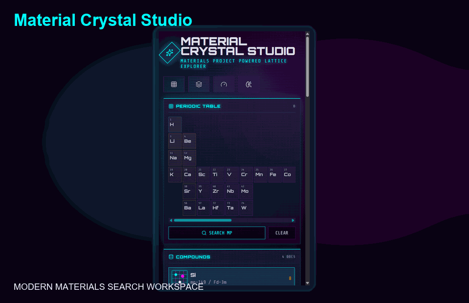

# Material Crystal Studio

**Material Crystal Studio** is a modern, research-oriented crystal structure explorer powered by the [Materials Project](https://next-gen.materialsproject.org/materials) and rendered through [Crystal Toolkit](https://docs.crystaltoolkit.org/). It keeps the dramatic black-studio interface of a custom web app while using Materials Project raw structures as the source of truth for 3D crystal rendering.



## Why This Exists

Materials Project is excellent for scientific data. Material Crystal Studio experiments with a more cinematic, dashboard-style interface for exploring compounds, lattice metadata, element systems, and MP-compatible 3D structures in one local app.

The design goal is simple: keep a high-texture frontend, but do not invent crystal geometry. The default viewer delegates structure rendering to Crystal Toolkit, the same open-source ecosystem that powers Materials Project visualization workflows.

## Highlights

- **MP-compatible 3D viewer** using `crystal-toolkit` and raw Materials Project `structure` payloads.
- **Modern black studio UI** with a dense materials dashboard, neon controls, and responsive panels.
- **Periodic Table search** for single-element systems like `Si` and multi-element systems like `Li-Fe-P-O`.
- **Materials Project API proxy** through the local dev server, so `MP_API_KEY` never reaches browser JavaScript.
- **Research panels** for symmetry, lattice constants, density, energy, band gap, and atomic site summaries.
- **Local cached dataset** for quick startup, plus scripts to fetch fresh MP data.
- **Verification scripts** for API URL contracts, cached MP structures, Crystal Toolkit smoke checks, and production builds.

## Tech Stack

- React 19 + TypeScript + Vite
- Crystal Toolkit + Dash + pymatgen
- Materials Project API
- Three.js / React Three Fiber fallback utilities
- Node test runner for local checks

## Quick Start

### 1. Clone and install JavaScript dependencies

```bash
git clone https://github.com/<your-name>/material-crystal-studio.git
cd material-crystal-studio
npm install
```

On Windows PowerShell, if `npm` is blocked by execution policy, use `npm.cmd`:

```powershell
npm.cmd install
```

### 2. Install Python viewer dependencies

Use Python 3.11+.

```bash
pip install -r requirements.txt
```

### 3. Add your Materials Project API key

Create `MP_API.env` or `.env` in the project root:

```env
MP_API_KEY=your_materials_project_api_key_here
```

Both files are ignored by git. You can copy from `.env.example`.

### 4. Run the app

```bash
npm run dev
```

Open:

```text
http://127.0.0.1:5173/
```

The dev command starts both:

- Vite frontend
- Local Crystal Toolkit viewer service

## Materials Project Data

The app ships with a small cached dataset in:

```text
public/data/materials-summary.json
```

To fetch/update data from Materials Project:

```bash
npm run fetch:materials
```

Runtime query results are written to:

```text
public/data/runtime-materials-summary.json
```

That runtime cache is ignored by git.

## Verification

Run the full local check suite before publishing changes:

```bash
npm test
npm run build
npm run verify
npm run smoke:dev
```

What these checks cover:

- MP API URL construction, including single-element `chemsys=Si`
- Cached MP structures for examples like `GaN`, `SrTiO3`, `Si`, and `LiFePO4`
- Crystal Toolkit server startup and material-id routing
- Production Vite build
- Dev server smoke test with CT iframe routing

## Project Structure

```text
.
|-- docs/assets/                 # README preview GIF and poster assets
|-- public/data/                 # cached public Materials Project sample data
|-- scripts/
|   |-- ct-viewer-server.py      # local Crystal Toolkit Dash viewer
|   |-- dev-server.mjs           # Vite + CT service launcher
|   |-- fetch-materials.mjs      # Materials Project fetch script
|   |-- smoke-dev.mjs            # dev server smoke test
|   `-- verify.mjs               # static + CT verification
|-- src/
|   |-- App.tsx                  # main UI
|   |-- data/elements.ts         # Periodic Table model
|   |-- materials-data.js        # MP document mapping
|   |-- mp-api-client.js         # MP API URL/key helpers
|   `-- styles.css               # black studio interface
|-- test/                        # node:test coverage
|-- .env.example
|-- requirements.txt
|-- package.json
`-- README.md
```

## Notes on Accuracy

Material Crystal Studio uses raw Materials Project structures as the default source of truth and embeds Crystal Toolkit for the 3D viewer. The custom Three.js renderer remains only as fallback/debug code. If Materials Project production uses private viewer settings that are not available in open-source Crystal Toolkit, small lighting or UI differences may remain, but structure topology and raw input data are aligned with the public MP/Crystal Toolkit workflow.

## Public Repo Checklist

Before pushing to GitHub:

- Confirm `.env` and `MP_API.env` are not tracked.
- Run `npm test` and `npm run build`.
- Keep `docs/assets/preview.gif` tracked.
- Do not commit `node_modules/`, `dist/`, runtime caches, or local screenshots.

## License

MIT
