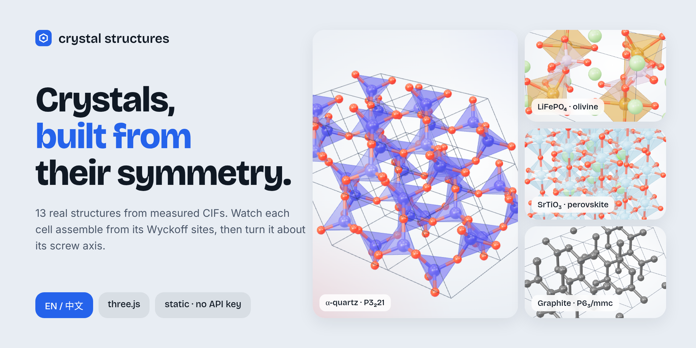
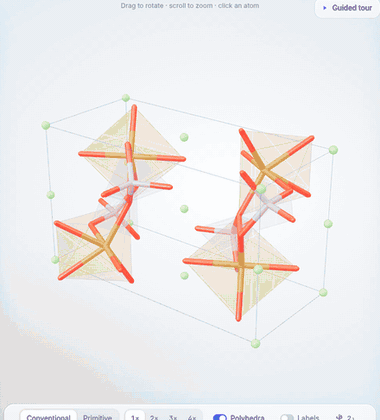
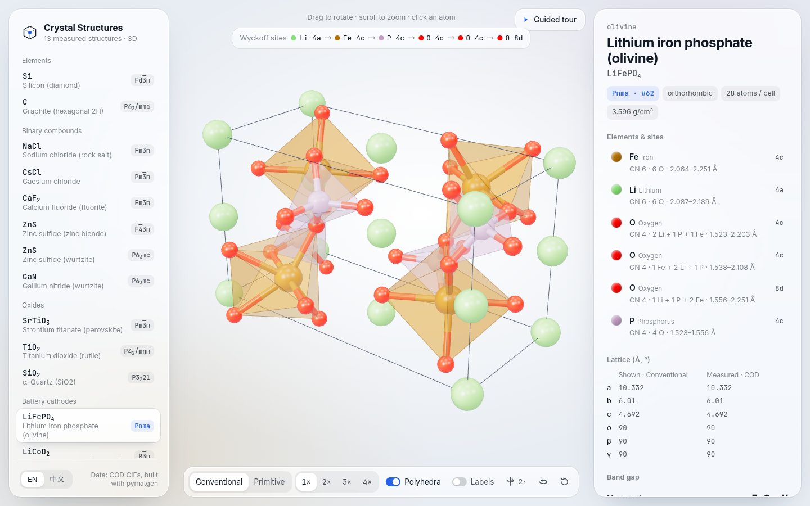
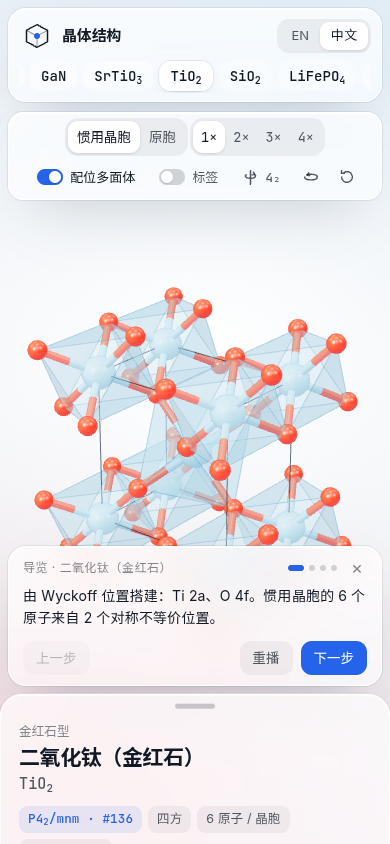

<p align="center"></p>

<h1 align="center">crystal structures</h1>

<p align="center">
  <b>An interactive 3D viewer for 13 real crystal structures, built from measured CIFs and their space-group symmetry.</b><br>
  English · 中文
</p>

<p align="center">
  
  
  
  
  <a href="LICENSE"></a>
</p>

---

<table><tr>
<td width="58%"></td>
<td>
<b>What you can do</b><br><br>
<b>Build</b>: watch each cell assemble one Wyckoff orbit at a time. Bonds grow out of the atoms, and coordination polyhedra fade in.<br><br>
<b>Morph</b>: switch between the primitive and conventional cells. Shared atoms stay put while the cell edges interpolate.<br><br>
<b>Grow</b>: go from a 1×1×1 cell up to a 4×4×4 supercell.<br><br>
<b>Spin</b>: rotate the cell about its main rotation or screw axis (4₁ in Si, 3₂ in quartz, 6₃ in GaN). A ghost copy shows that the structure maps onto itself.<br><br>
<b>Tour</b>: a 3–4 step guided tour for every structure (EN / 中文).<br><br>
<b>Inspect</b>: hover or click any atom to see its Wyckoff site, coordination number and neighbours.
</td></tr></table>

| Desktop | Phone (中文, guided tour) |
|---|---|
|  |  |

## The structures

| | Structure | Space group | Spin axis |
|---|---|---|---|
| Elements | Si (diamond) · C (graphite 2H) | Fd-3m · P6₃/mmc | 4₁ · 6₃ |
| Binary | NaCl · CsCl · CaF₂ · ZnS zinc blende · ZnS wurtzite · GaN | Fm-3m · Pm-3m · Fm-3m · F-43m · P6₃mc · P6₃mc | 4 · 4 · 4 · 3 · 6₃ · 6₃ |
| Oxides | SrTiO₃ · TiO₂ rutile · α-SiO₂ quartz | Pm-3m · P4₂/mnm · P3₂21 | 4 · 4₂ · 3₂ |
| Battery cathodes | LiFePO₄ (olivine) · LiCoO₂ (layered) | Pnma · R-3m | 2₁ · 3 |

How the data is handled:
- **Geometry** comes from a measured, open-licence CIF in the [Crystallography Open Database](https://www.crystallography.net/). pymatgen refines it at build time (`symprec 0.02`), and the refined lattice is checked against the CIF.
- **Band gaps** come in two tiers:
  - *primary* values carry a DOI and an abstract quote. These cover NaCl, CaF₂, rutile, LiFePO₄, LiCoO₂ and α-quartz; graphite is a semimetal (ARPES), so no gap is shown.
  - *secondary* values (Wikipedia) are labelled that way in the UI.
- **DFT gaps** are always shown separately as *computed*, never as *measured*.
- Each structure has its sources in `refs/<id>/REFS.md`.

## Run locally

```bash
npm ci
npm run dev          # http://localhost:5173
npm run build        # static site in dist-v2/ (works from any sub-path)
npm test             # geometry (node) + structure/data checks (pytest)
npm run perf         # perf regression gate: headless Chrome, median of 3, fails on >1.5× vs baseline
```

At runtime the viewer only reads `public/structures/*.json`. There is no server, no API key and no network call.

Deep links:
- `?m=quartz&cell=primitive&n=2&lang=zh` opens a given structure, cell, supercell size and language.
- `?tour=1` starts the guided tour.
- `?rot=0` turns auto-rotate off, and `?motion=0` turns all animation off. The `prefers-reduced-motion` setting is also respected.

## Rebuild the data

Rebuilding the data needs Python with pymatgen, which is not required for the site itself:

```bash
python -m venv .venv && . .venv/bin/activate && pip install pymatgen pytest
npm run data         # build/build_structures.py -> public/structures/*.json, build/write_refs.py -> refs/*/REFS.md
```

## Layout

```
v2/                  the app: index.html, src/{main,geometry,i18n,tours}.js, style.css, perf/
build/               materials.py (sources + gaps), build_structures.py (pymatgen), write_refs.py
data/cif/            the measured CIFs
public/structures/   generated JSON the viewer loads
refs/<id>/REFS.md    per-structure provenance
tests/               pytest data checks
.github/workflows/   pages.yml (manual-dispatch GitHub Pages deploy)
docs/                banner, GIF, screenshots, V2_MIGRATION.md
```

The earlier React + Materials Project app is still in the tree (`src/`, `scripts/`, `test/`). Its scripts were renamed to `npm run legacy:*`. [docs/V2_MIGRATION.md](docs/V2_MIGRATION.md) explains how it will be removed.

## Licence

MIT. The CIFs are from COD (CC0 / public domain).
